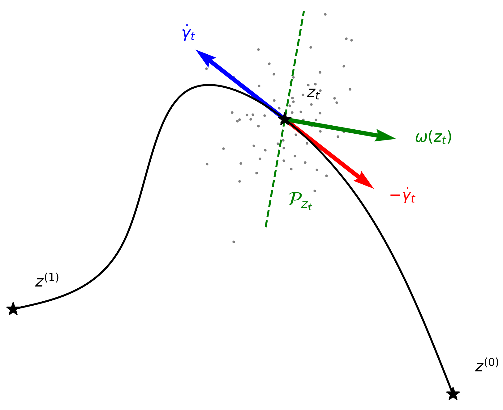

<div align="center">

# Learning Directional Randers Geometry for Latent-Space Exploration

**[Théau Blanchard](https://theaublanchard.github.io/)** · **[Stéphanie Allassonnière](https://sites.google.com/site/stephanieallassonniere/)**

[](https://arxiv.org/abs/2611.03675)
[](https://www.python.org/)
[](LICENSE)


</div>

<p align="center">
  
</p>

## Overview

Latent spaces induced by generative models are commonly equipped with a symmetric
Riemannian metric. This repository accompanies our work on learning **directional
Randers geometries** instead: a Finsler metric that can represent asymmetric travel
costs and therefore support more faithful latent-space exploration.

The code includes the training, evaluation, and analysis pipelines used to produce
the experiments and figures in the paper.

> **Paper:** [Learning Directional Randers Geometry for Latent-Space Exploration](https://arxiv.org/abs/2611.03675)

## Installation

The project uses [uv](https://docs.astral.sh/uv/) for environment and dependency
management. Install `uv`, then run:

```bash
git clone https://github.com/Theaublanchard/finsler_learning.git
cd finsler_learning
uv sync
```

## Reproducing the results

All experiments can be reproduced from the scripts and notebooks in
[`src/finsler_learning/`](src/finsler_learning/). Update the export paths in the
relevant scripts or notebooks before running them.

### Main experiments

The following commands reproduce the base experiments for the Shepp–Logan and
KOMATSUNA datasets:

```bash
bash src/finsler_learning/shepplogan_pipeline/run_shepplogan_base.sh
bash src/finsler_learning/komatsuna_pipeline/run_komatsu_base.sh
```

| Results | Analysis |
| --- | --- |
| Tables 1, 2, 5, and 6; Figures 3 and 4 | [`shepplogan_pipeline/analyze_results.ipynb`](src/finsler_learning/shepplogan_pipeline/analyze_results.ipynb) and [`komatsuna_pipeline/analyze_results.ipynb`](src/finsler_learning/komatsuna_pipeline/analyze_results.ipynb) |
| Figures 2, 7, 8, 9, and 10 | [`shepplogan_pipeline/display_results.ipynb`](src/finsler_learning/shepplogan_pipeline/display_results.ipynb) and [`komatsuna_pipeline/display_results.ipynb`](src/finsler_learning/komatsuna_pipeline/display_results.ipynb) |
| Figure 1(b) | [`shepplogan_pipeline/vignette_paper.ipynb`](src/finsler_learning/shepplogan_pipeline/vignette_paper.ipynb) |

### Ablation studies

Run each experiment with the corresponding shell script, then inspect the results
in the linked notebook:

| Study | Run | Analysis |
| --- | --- | --- |
| Amplitude parametrization (Table 3) | [`run_shepplogan_dummy_acc.sh`](src/finsler_learning/shepplogan_pipeline/run_shepplogan_dummy_acc.sh) | [`analyze_results_dummy_acc.ipynb`](src/finsler_learning/shepplogan_pipeline/analyze_results_dummy_acc.ipynb) |
| Label-noise robustness (Table 4) | [`run_shepplogan_label_noise.sh`](src/finsler_learning/shepplogan_pipeline/run_shepplogan_label_noise.sh) | [`analyze_results_label_noise.ipynb`](src/finsler_learning/shepplogan_pipeline/analyze_results_label_noise.ipynb) |
| Extrapolation hyperparameter (Figures 5 and 6) | [`run_shepplogan_extrapolation_ablation.sh`](src/finsler_learning/shepplogan_pipeline/run_shepplogan_extrapolation_ablation.sh) | [`analyze_results_extrapolation_ablation.ipynb`](src/finsler_learning/shepplogan_pipeline/analyze_results_extrapolation_ablation.ipynb) |

### Additional analyses

- [`inspect_convergence_hamiltonian.py`](src/finsler_learning/shepplogan_pipeline/inspect_convergence_hamiltonian.py)
  inspects convergence of the Hamiltonian dynamics.
- [`explore_amplitutude_results.ipynb`](src/finsler_learning/shepplogan_pipeline/explore_amplitutude_results.ipynb)
  explores the amplitude and curl of the learned vector field.
- [`check_densities.ipynb`](src/finsler_learning/shepplogan_pipeline/check_densities.ipynb)
  and [`komatsuna_pipeline/check_densities.ipynb`](src/finsler_learning/komatsuna_pipeline/check_densities.ipynb)
  inspect latent-space metric hyperparameter densities and calibration.

## Repository structure

```text
src/finsler_learning/
├── base_*.py                    # Shared models, trainers, and evaluation tools
├── shepplogan_pipeline/         # Shepp–Logan experiments
└── komatsuna_pipeline/          # KOMATSUNA experiments
```

## Citation

If you use this code or the associated methodology in your research, please cite:

```bibtex
@article{blanchard2026learning,
  title   = {Learning Directional Randers Geometry for Latent-Space Exploration},
  author  = {Blanchard, Th{\'e}au and Allassonni{\`e}re, St{\'e}phanie},
  journal = {arXiv preprint arXiv:2611.03675},
  year    = {2026}
}
```

## License

This project is distributed under the terms of the [MIT License](LICENSE).
